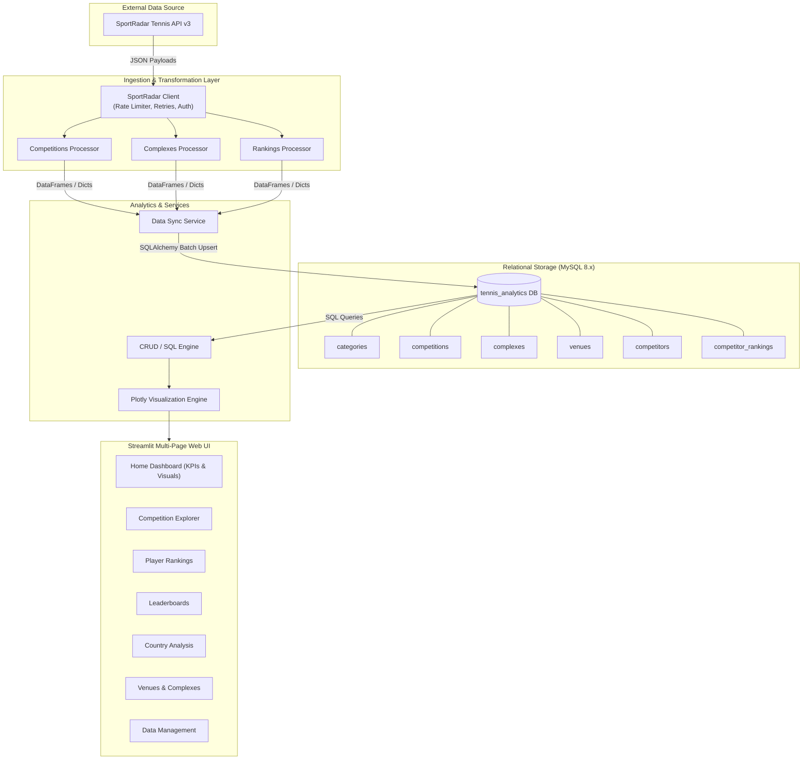
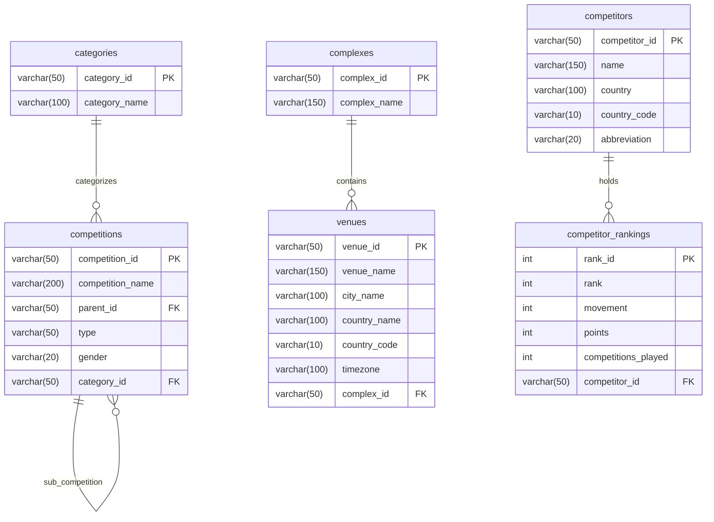

# Game Analytics: Unlocking Tennis Data with SportRadar API

A professional, end-to-end sports analytics web platform that extracts, structures, and visualizes international tennis data from the official **SportRadar Tennis API**. The platform normalizes nested JSON payloads into a high-performance **MySQL** relational database and provides real-time interactive business intelligence dashboards powered by **Python**, **SQLAlchemy**, **Streamlit**, and **Plotly**.

---

## 1. Project Overview & Problem Statement

Modern tennis generates vast amounts of data across global competitions, sports complexes, and competitor rankings. However, this raw data is typically served as deeply nested, dynamic JSON payloads from REST APIs. Sports analysts, tournament directors, and media organizations need an automated, reliable system to:

1. **Ingest and Normalize Raw Tennis Data**: Transition from raw JSON structures to a clean 3NF relational database schema.
2. **Track Complex Hierarchy and Standings**: Model relationships between parent tournaments, sub-competitions, sports complexes, venues, and doubles competitor rankings.
3. **Perform Advanced SQL Analytics**: Answer critical operational and competitive queries with high efficiency.
4. **Deliver Actionable Insights via Interactive UI**: Empower users to explore player momentum, country power rankings, and venue logistics through a modern sports analytics interface.

---

## 2. Key Objectives

- **API Integration**: Robust integration with official Sportradar Tennis API endpoints (Competitions, Complexes, and Doubles Competitor Rankings) with automated rate-limiting, error handling, and exponential backoff.
- **Relational Data Modeling**: A normalized MySQL 8.x schema (`tennis_analytics`) with primary keys, foreign keys, cascade rules, and indexing for low-latency queries.
- **Data Transformation Pipeline**: Resilient Pandas ETL pipelines that validate required fields, remove duplicate records, and prevent circular foreign key dependencies.
- **Analytical Query Engine**: Implementation of 20 standardized SQL queries addressing competition hierarchy, venue logistics, and player points.
- **Sports Analytics Dashboard**: A multi-page Streamlit application with custom dark-navy and tennis-green aesthetics, interactive Plotly visualizations, responsive KPI cards, and an administration console.

---

## 3. Technology Stack

| Domain | Technology | Description |
| :--- | :--- | :--- |
| **Backend & Pipeline** | Python 3.11+ | Core data processing and business logic |
| **API Ingestion** | Requests / Session | HTTP client with retry policies & rate limiting |
| **Data Processing** | Pandas & NumPy | JSON parsing, normalization, validation, and deduplication |
| **Database ORM** | SQLAlchemy 2.x | ORM modeling, transaction management, connection pooling |
| **Database Engine** | MySQL 8.x (PyMySQL) | Primary relational database (with SQLite fallback) |
| **Web Application** | Streamlit | Responsive multi-page web application framework |
| **Visualizations** | Plotly Express & Graph Objects | Dynamic, interactive charts with custom sports theme |
| **Configuration** | python-dotenv | Secure environment variable management |
| **Testing** | pytest | Automated unit and integration testing |

---

## 4. System Architecture



---

## 5. Relational Database Schema (`tennis_analytics`)



### Table Specifications:

1. **`categories`**: Stores tennis circuits and associations (e.g., Grand Slam, ATP Tour, WTA Tour, ITF Men).
2. **`competitions`**: Stores tournaments with self-referencing hierarchy (`parent_id`) and category links (`category_id`).
3. **`complexes`**: Stores multi-court sports complexes (e.g., Stade Roland Garros, Melbourne Park).
4. **`venues`**: Stores individual stadium courts linked to complexes with city, country, and timezone attributes.
5. **`competitors`**: Stores doubles pairs or competitors with nationality and abbreviation.
6. **`competitor_rankings`**: Tracks rank position, weekly movement, points, and competitions played.

---

## 6. Official SportRadar API Integration

The application integrates with three official SportRadar Tennis API v3 endpoints:

| Module | Endpoint | Method | Extracted Entities |
| :--- | :--- | :--- | :--- |
| **Module A** | `/competitions.json` | GET | Tournaments, Parent Tournaments, Formats, Categories |
| **Module B** | `/complexes.json` | GET | Sports Complexes, Venues, Cities, Countries, Timezones |
| **Module C** | `/double_competitor_rankings.json` | GET | Competitors, Rank, Movement, Cumulative Points, Matches |

### Robust Ingestion Engineering:
- **Rate-Limiter**: Automatically paces calls at **1.2s delay** to respect trial 1 QPS limits.
- **Exponential Backoff**: Intercepts HTTP 429 and 5xx errors with automatic retry and backoff.
- **Fail-Safe Fallback**: If no API key is supplied, a verified SportRadar-shaped sample dataset is available on the Data Management page.

---

## 7. SQL Data Analysis Queries

All 20 analytical queries are maintained in [`sql_queries/analysis_queries.sql`](file:///s:/Innvovexis%20Project/10%20project/tennis-game-analytics/sql_queries/analysis_queries.sql):

### Competition Analysis:
1. List all competitions along with their category name.
2. Count the number of competitions in each category.
3. Find all competitions of type doubles.
4. Get competitions belonging to a specific category.
5. Identify parent competitions and their sub-competitions.
6. Analyze the distribution of competition types by category.
7. List all competitions with no parent (top-level tournaments).

### Venue & Complex Analysis:
1. List all venues along with their associated complex name.
2. Count the number of venues in each complex.
3. Get venue details for a specific country.
4. Identify all venues and their timezones.
5. Find complexes that have more than one venue.
6. List venues grouped by country.
7. Find all venues for a specific complex.

### Competitor Ranking Analysis:
1. Get all competitors with their rank and points.
2. Find competitors ranked in the top 5.
3. List competitors with no rank movement (stable positions).
4. Get total points of competitors from a specific country.
5. Count the number of competitors per country.
6. Find competitors with the highest points in the current dataset.

---

## 8. Project Folder Structure

```
tennis-game-analytics/
│
├── app.py                      # Main Streamlit application entry point (Home Dashboard)
├── config.py                   # Centralized configuration, endpoints, & database URIs
├── requirements.txt            # Python dependencies
├── .env.example                # Example environment configuration file
├── .gitignore                  # Git ignore rules (protects credentials & cache)
├── README.md                   # Complete documentation
│
├── database/
│   ├── connection.py           # SQLAlchemy engine & session manager with MySQL/SQLite fallback
│   ├── schema.sql              # MySQL DDL table creation and indexing scripts
│   ├── models.py               # SQLAlchemy ORM declarative models (6 tables)
│   └── crud.py                 # Batch upserts and analytical SQL query executions
│
├── api/
│   ├── sportradar_client.py    # Official API client (auth, rate limits, retries)
│   ├── competitions.py         # Module A: Competitions fetcher
│   ├── complexes.py            # Module B: Complexes & venues fetcher
│   └── rankings.py             # Module C: Doubles rankings fetcher
│
├── data_processing/
│   ├── competition_processor.py # Parses & transforms competition JSON
│   ├── venue_processor.py       # Parses & transforms complex/venue JSON
│   └── ranking_processor.py     # Parses & transforms rankings JSON
│
├── services/
│   ├── data_sync.py            # Synchronization service & demo dataset loader
│   └── analytics.py            # Plotly interactive chart generators
│
├── pages/
│   ├── 1_Competition_Explorer.py # Tournament search, filters & hierarchy drill-down
│   ├── 2_Player_Rankings.py      # Standings, filters, sliders, & CSV export
│   ├── 3_Leaderboards.py         # Podium Top 3, Top 5/10/20, & Movers
│   ├── 4_Country_Analysis.py     # Global participation, totals & averages
│   ├── 5_Venues_Complexes.py     # Arena exploration & court counts
│   └── 6_Data_Management.py      # Connectivity tests, ETL triggers & sync logs
│
├── sql_queries/
│   └── analysis_queries.sql    # 20 standard SQL analysis queries
│
├── utils/
│   ├── helpers.py              # Formatting numbers, badges, timestamps
│   └── validators.py           # Integrity validators for raw records
│
├── assets/
│   └── logo.png                # Application branding logo
│
└── tests/
    ├── test_api.py             # Unit tests for API client & error handling
    ├── test_processing.py      # Unit tests for JSON extraction & transformation
    └── test_database.py        # Integration tests for database schema & queries
```

---

## 9. Local Installation & Execution Guide

### Prerequisites
- Python 3.11 or higher
- MySQL 8.x (optional for SQLite fallback testing, recommended for production)

### Step 1: Clone the Repository
```bash
git clone https://github.com/your-username/tennis-game-analytics.git
cd tennis-game-analytics
```

### Step 2: Create and Activate Virtual Environment
```bash
# Windows
python -m venv venv
venv\Scripts\activate

# macOS / Linux
python3 -m venv venv
source venv/bin/activate
```

### Step 3: Install Dependencies
```bash
pip install -r requirements.txt
```

### Step 4: Configure Environment Variables
Copy `.env.example` to `.env`:
```bash
cp .env.example .env
```
Edit `.env` with your settings:
```ini
SPORTRADAR_API_KEY=your_actual_api_key_here
SPORTRADAR_ACCESS_LEVEL=trial

DB_HOST=localhost
DB_PORT=3306
DB_USER=root
DB_PASSWORD=your_mysql_password
DB_NAME=tennis_analytics
```

### Step 5: Initialize MySQL Database (Optional)
If running with MySQL, create the database:
```sql
CREATE DATABASE tennis_analytics;
```
*(The application will automatically create all tables on first startup).*

### Step 6: Launch the Streamlit Web Application
```bash
streamlit run app.py
```
Open your browser at `http://localhost:8501`.

### Step 7: Run Automated Unit Tests
```bash
pytest -v tests/
```


